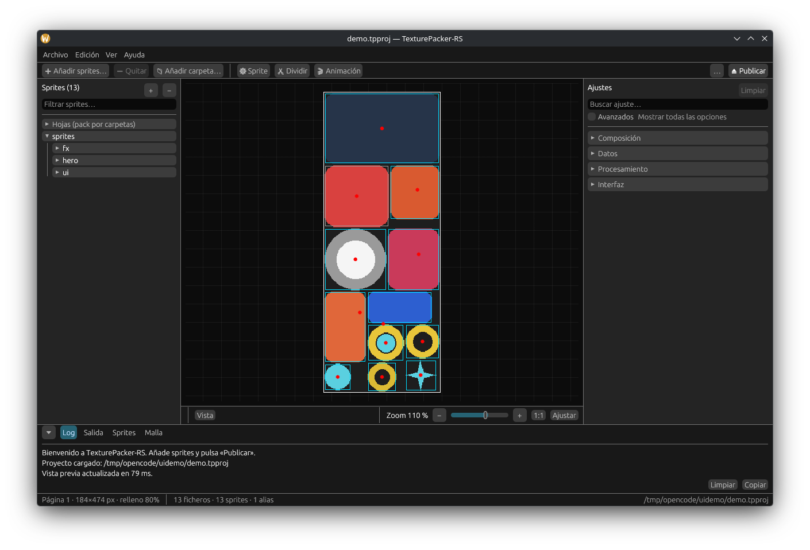
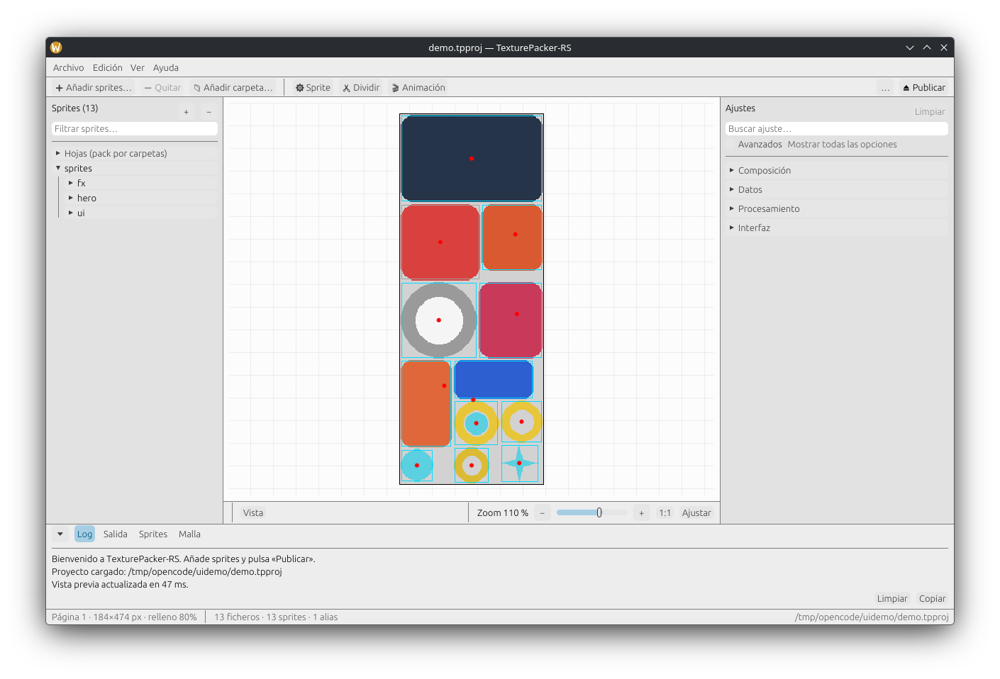

# TexturePacker-RS 🧩

**English** | [Español](README.es.md)

[](https://github.com/Eduar2TC/texturepacker-rs/actions/workflows/ci.yml)

A **Rust** desktop application for building texture atlases, developed
independently (input: CLI / GUI / project file; pipeline: ingest → polygons →
packing → VRAM → export).

```
Entry layer (CLI / GUI / .tpproj / .tps)
        │
        ▼
1. Ingest & preprocessing    (parallel loading, trimming, hashing, aliases, variants)
        │
        ▼
2. Geometry & meshes         (Marching Squares → RDP → Earcut)
        │
        ▼
3. Spatial packing           (MaxRects BSSF/BAF/BLSF, Guillotine, 90° rotation, multi-atlas)
        │
        ▼
4. Pixel processing          (extrude, rotation, normal maps, quantization, dithering)
        │
        ▼
5. Export & encryption       (PNG/WebP/ASTC/ETC2, AES-256-GCM, Mustache templates)
```

## Screenshots

The sample project already packed on open: the preview auto-fits on the first
load and the thin border marks the page limit inside the canvas.

| Dark theme | Light theme |
|-------------|------------|
|  |  |

The same screen in English — the screenshots above show the Spanish
interface, the other of the two languages the app ships in. Language and
theme are chosen under **Settings → Interface** and are stored per machine,
not per project; in English the plurals of the status bar read
concorded («13 files · 13 sprites · 1 alias»):


## Components

| Crate        | Description                                                              |
|--------------|--------------------------------------------------------------------------|
| `tp-core`    | Engine: full pipeline, Rayon-parallel, no global mutable state.          |
| `tp-app`     | Desktop app (egui/eframe): sprite tree, atlas preview with zoom, settings (basic/advanced), Log/Output/Sprites/Mesh tabs, pivots, interface in English or Spanish with light/dark theme. |
| `tp-cli`     | Command-line interface for headless/CI.                                  |

## Downloads

Whenever a version is published (tag `v*`), the release workflow builds and
attaches to the
[Releases](https://github.com/Eduar2TC/texturepacker-rs/releases) page the
`tp-cli` binaries for Linux x64/arm64, Windows x64 and macOS (Apple Silicon
and Intel), and `tp-app` for Linux x64, Windows and macOS.

The files use friendly names (`tp-cli-linux-x64.tar.gz`,
`tp-app-macos-arm64.dmg`, `texturepacker-rs-windows-x64.msi`…). Besides the
archives, there are **native installers**: a (ad-hoc) signed `.dmg` on macOS,
a WiX `.msi` on Windows (installs tp-app and tp-cli, adds tp-cli to the PATH)
and a Linux zip with an icon and a `.desktop` launcher.

What changed in each version is documented in the release notes of that
version, on the Releases page; this README describes the program as it is
today.

```bash
# Example: use the CLI from the latest release (Linux x64)
curl -LO https://github.com/Eduar2TC/texturepacker-rs/releases/latest/download/tp-cli-linux-x64.tar.gz
tar -xzf tp-cli-linux-x64.tar.gz && ./tp-cli --help
```

The desktop app on Linux needs the system GTK3 libraries (`libgtk-3` on
Debian/Ubuntu); the binaries do not bundle them.

The Linux binaries are built on Ubuntu 22.04, so they require **glibc ≥
2.35** (Ubuntu 22.04+, Debian 12+, Fedora 36+, Mint 21+). On older systems,
build from source: `cargo install --path crates/tp-cli`.

## Build and run

Requires Rust ≥ 1.93 and a C/C++ compiler only when ASTC is enabled.

```bash
# Desktop app
cargo run -p tp-app

# Open a project directly
cargo run -p tp-app -- path/to/project.tpproj   # also accepts project.tps

# App self-test: opens a sample project and verifies the preview
# without human interaction (prints SMOKE PASS and exits 0 on success)
cargo run -p tp-app --bin tp-smoke

# CLI
cargo run -p tp-cli -- --help

# With ASTC and Basis support (compiles astcenc and Basis Universal from source; ~1-2 min extra)
cargo build --features gpu-formats

# Tests
cargo test --workspace
```

## Quick start (GUI)

The workspace is **dynamic**: adding or removing sprites and changing
settings repacks the atlas instantly (in-memory preview, no files written),
with directory watching — editing a PNG on disk refreshes the view.
«Publish» exports the images and the metadata.

The window organizes the workflow into several zones:

| Zone | Contents |
|------|-----------|
| Menu bar | **File** (Open project `Ctrl+O`, Save project `Ctrl+S`, Reset settings with confirmation, Quit `Ctrl+Q`), **Edit** (Undo the last change `Ctrl+Z`, Remove the selected sprites `Del`), **View** (Zoom in/Zoom out/Zoom to 100%/Fit with `+`/`−`/`0`/`F`, Bottom panel, Show Settings) and **Help** (Keyboard shortcuts `F1`, Tutorial, About) |
| Toolbar | **➕ Add sprites…**, **➖ Remove**, **📁 Add folder…** (smart folder), **⚙ Sprite** (sprite settings: pivots and 9-patch borders), **✂ Split** (sheet) and **🎬 Animation** (preview); on the right, the main action **⏏ Publish** with its **…** menu: **Force publish** rewrites the files even if nothing changed, and if nothing changed a normal publish is skipped with a notice in the Log |
| Left panel | **Sprites** tree: folders and files; single or multiple selection (Ctrl/Shift), drag and drop, «↺ Restore (N)» to undo exclusions |
| Center | Atlas preview: bar with the **View** menu (outlines, pivots and 9-patch borders), the pages and the selected sprite; zoom (−/slider/+/1:1/Fit, Ctrl+wheel or pinch); on the sprite, the **red cross of the pivot** and the **green bars of the 9-patch borders** are draggable with the mouse; below, the **Log**, **Output**, **Sprites** and **Mesh** tabs |
| Right panel | **Settings**: **Interface** (language **System/Español/English** and theme **System/Light/Dark**, stored in `~/.config/texturepacker-rs/ui.toml` and applied on the fly), Data (directories, base name with placeholders `{n}`/`{n1}`/`{v}`, **metadata format (63 presets grouped by family + «Recommended values»)**, strip the extension from names, prepend the smart folder's folder, texture path in the metadata), Layout (size, **multipack**, padding, **border padding**, **common divisor**, **align to grid**, extrude, rotation, trim, **algorithm/heuristic/packing mode**, **size constraints, fixed size and squared atlas**), Processing (color, dithering, **alpha handling**, **scale variants**, output format) and, behind the **Advanced** switch, polygons, aliases, variants, encryption, templates, **custom exporters** (a folder of `<id>.hbs` files usable as the output template) and **template properties** (CSS prefix/media query and `string_property`/`bool_property`) |
| Floating windows | **✂ Split sheet**: pick a sheet, cut by grid (columns × rows) or fixed size with margin/spacing, preview the grid and write the PNGs, add them to the project and publish. **🎬 Animation preview**: groups by file name, frame slider, transport (⏮ ⏭), **Loop** and **Play** checkboxes, FPS (1-60), background (dark/light/checker/custom) and scale |

1. **Drag images, folders or a project (`.tpproj`/`.tps`) onto any part of
   the window** (or use **➕ Add sprites** / **📁 Add folder**, or fill in
   **Input directory**): 28 image formats in 30 extensions are accepted (PNG,
   WebP, JPEG, TGA, BMP, GIF, ICO, TIFF, DDS, QOI, PBM/PGM/PPM, XBM, XPM,
   PSD, SVG/SVGZ, ASTC, KTX/KTX2, PKM, PVR/PVRTC (v2 and v3), `.pvr.gz`,
   `.pvr.ccz` and `.basis` with `--features gpu-formats`).
   Every settings change repacks the view instantly (120 ms debounce).
2. Set atlas size, padding/extrude, rotation, trim, polygons, color depth,
   format and encryption.
3. Press **«⏏ Publish»**: the preview shows the atlas with frames, pivots,
   9-patch borders and auto-zoom, and the *Log* tab lists the time of each
   stage.
4. Edit the pivot by dragging its **red cross** (or with the nine preset
   positions) and the 9-patch borders with their **green bars**, in the view
   or in **⚙ Sprite**; **💾 Save pivots** writes `pivots.json` and
   `borders.json` next to the sprites. Save the configuration with
   **File → Save project** (`.tpproj` or `.tps`) to reuse it.

In the preview: **drag a sprite** to move it (with the *Manual* algorithm it
fixes its position; with the others it shows a ghost view suggesting Manual
mode), **drag from an empty area** to rubber-band select several, **click
empty space** to deselect and **Del** removes the selected ones. Shortcuts:
`Ctrl+O` open, `Ctrl+S` save, `Ctrl+P` publish, `Ctrl+Shift+P` force
publish, `Ctrl+Z` undo, `+`/`−`/`0` zoom (1:1), `F` fit, `Esc` closes
windows and dialogs and `F1` shows the full shortcut list.

## Quick start (CLI)

```bash
# Saved project (our TOML one or the original's XML one)
tp-cli pack project.tpproj
tp-cli pack project.tps

# Everything by parameters
tp-cli pack --input sprites/ --output build/ \
    --max-size 4096 --padding 2 --extrude 1 --format etc2 \
    --strategy bssf --variants 1.0,0.5 --key secret --template-format json

# Positional sprites by hand, --format with a double meaning (texture or
# data) and metadata with --data/--sheet
tp-cli pack sprites/ hero.png --format phaser \
    --sheet build/atlas.png --data build/atlas.json --verbose

# Texture settings: border, divisor, grid, transparency and path
tp-cli pack --input sprites/ --output build/ \
    --border-padding 8 --common-divisor 4 --align 4 \
    --alpha-handling premultiply --scale-mode fast \
    --texture-path /assets --keep-extension --prepend-folder-name \
    --dither floyd-alpha

# Packing: algorithm, heuristic, minimum size and constraints
tp-cli pack --input sprites/ --output build/ \
    --algorithm basic --basic-sort-by name --basic-order descending \
    --pack-mode best --size-constraints pot --force-squared

# Multipack: placeholders {n}/{n0} (from 0), {n1} (from 1) and {v}
tp-cli pack --input sprites/ --output build/ --max-size 1024 \
    --base-name 'sheet{n1}{v}' --variants 1.0,0.5
#   → sheet1.png, sheet1.json, sheet2.png, sheet2.json, sheet1-hd.png, ...
tp-cli pack --input sprites/ --output build/ --no-multipack   # fails if it doesn't fit in one sheet

# Decrypt an encrypted texture
tp-cli decrypt build/atlas_0.png.tpenc --key secret -o atlas.png

# Preview with the atlas pixel format (fixes the channel order,
# e.g. BGRA8888 becomes RGBA so the colors look right)
tp-cli decrypt build/atlas_0.png.tpenc --key secret -o atlas.png --pixel-format bgra8888
```

Unknown options are rejected with `error: unknown option: … (run --help to
see the options)`; the help covers every option that can be typed and
`--version`/`-V` and `--exporter-list` exist.
`--data` and `--sheet` must share folder and base name (the model has a base
name per run) and the `--data` extension must match the chosen data format.
These options are also implemented: `--scale`, `--max-width`/`--max-height`,
`--background-color`, `--ignore-files`, `--replace`, `--dpi`,
`--heuristic-mask`, `--convert-texture`, `--force-publish` and `--save`;
plus `--custom-exporters-directory`, `--css-sprite-prefix`,
`--css-media-query-2x`, `--plain-string-property`/`--plain-bool-property`
and the aliases `--disable-rotation`/`--enable-cache-busting`. The twelve
concrete exporter options that this project does not write are registered
but rejected stating which exporter they belong to; `--tracer-tolerance` and
`--content-protection` are still not accepted, due to differences in units
and in encryption.

## Spec coverage

| Spec module                                  | Status | Details |
|----------------------------------------------|--------|---------|
| Parallel image loading                       | ✅     | Rayon; PNG, WebP, JPEG, TGA, BMP, GIF, ICO, TIFF, DDS, QOI, PBM/PGM/PPM, XBM, XPM, PSD, SVG/SVGZ, ASTC, KTX/KTX2, `.basis` and Basis-compressed `.ktx2`* (*with `--features gpu-formats`), PKM, PVR/PVRTC v2 and v3, `.pvr.gz` and `.pvr.ccz` — 28 input formats |
| Alpha trimming + bounding box                | ✅     | Configurable threshold (0-255) |
| Deduplication by hashing (aliases)           | ✅     | xxh3 + byte-exact comparison; aliases take no space |
| Auto-downscaling (@2x/@1x)                   | ✅     | `scale_variants` (e.g. `1.0, 0.5`) with scaled metadata |
| Marching Squares + ambiguity                 | ✅     | Resolved with 8-direction connectivity analysis |
| Ramer–Douglas–Peucker                        | ✅     | Tolerance in pixels |
| Earcut triangulation                         | ✅     | Solid contours with every hole bridged into the mesh, so a donut stays open (`is_hole` contour) |
| Algorithm → Polygon                          | ✅     | *Trim mode Polygon* switches the algorithm to *Polygon* automatically (meshes + per-contour packing) |
| MaxRects BSSF / BAF / BLSF                   | ✅     | Selectable |
| Guillotine                                   | ✅     | Selectable |
| Grid / Basic                                 | ✅     | Grid (cell = largest inflated sprite) and left-to-right rows with `basic_sort_by`/`basic_order` |
| Manual (GUI)                                 | ✅     | Drag sprites in the preview to fix their position (`manual_positions`); the free ones fall into Basic rows below the fixed ones. Optional grid that snaps the drag (and, if you want, the flow of the free ones) and a «Clear manual positions» button (`manual_grid`) |
| Per-folder packing (groups)                  | ✅     | Assign sprites to groups in the sprite panel (drag or context menu); each group packs into `<output>/<group>/`, the main sheet stays at the root |
| Automatic per-folder packing                 | ✅     | `auto_folder_groups` (GUI or `--auto-folders`): each input subfolder produces its sheet in the homonymous output subfolder |
| Best / BottomLeft / ContactPoint heuristics  | ✅     | `Best` tries all 5 heuristics and keeps the tightest packing |
| Pack mode Fast / Good / Best                 | ✅     | Binary search for the minimum atlas (budget of 400 ms / 3 s); Fast only shrinks |
| Size constraints (AnySize/POT/MultipleOf4/WordAligned) | ✅  | Trim and search respect the constraint without exceeding `max_texture_size`; WordAligned uses the `color_depth` word size |
| Fixed size and squared atlas                 | ✅     | `fixed_width`/`fixed_height` (0 = automatic) and `force_squared` |
| 90° rotation                                 | ✅     | Pixels and meshes rotated coherently |
| Multi-atlas auto-split                       | ✅     | New page when it doesn't fit; VRAM limit |
| Multipack on/off                             | ✅     | `multipack` (on by default; GUI + `--no-multipack`); if off and it doesn't fit in one sheet, a clear error |
| Multipack placeholders                       | ✅     | `{n}`/`{n0}` (index from 0), `{n1}` (from 1) and `{v}` (variant suffix) in the base name; every sheet writes its data file; warning if missing |
| Polygon fit per bitmap / raster grid         | ✅     | Occupancy grid per page |
| Padding & Extrude                            | ✅     | Anti-bleeding |
| Border padding                               | ✅     | Margin between sprites and the atlas edge; rounded to the grid |
| Common divisor (x/y)                         | ✅     | Sprites are stretched (with transparency) until divisible; LCM with the grid |
| Align to grid (0 = off)                      | ✅     | Padding, border and positions rounded to multiples; notice in the GUI |
| Transparency (alpha handling)                | ✅     | keep / clear / reduce-border-artifacts (bleed) / premultiply-alpha; its own pipeline step |
| Scale variants                               | ✅     | smooth (bilinear) or fast (nearest neighbor) |
| Texture path in the metadata                 | ✅     | Prefix applied to `meta.image` and `pages[].file` (`--texture-path`) |
| Sprite names                                 | ✅     | Ids relative with subfolder; optional extension (`trim_sprite_names`) and optional smart folder |
| Pivots                                       | ✅     | Default + `pivots.json` + GUI editing |
| 9-patch / 3-patch borders                    | ✅     | `[left, top, right, bottom]` in pixels via `borders.json`, editor in the GUI (9-patch/3-patch presets), **automatic detection** of solid-color rows/columns («🔎 Detect» button; trims the outer transparent margin first, if any), green guides draggable with the mouse in the preview and a `border` metadata per frame |
| Co-packing of normal maps                    | ✅     | `*_normal.png` in the same frame/page/rotation |
| Quantization (RGBA4444/RGB565)               | ✅     | Applied to the whole page |
| Pixel format RGBA5551 / RGBA5555 / BGRA8888  | ✅     | `pixel_format = "RGBA5551"` quantizes to the 5-5-5-1 grid (bit-replication expansion, alpha 0/255); `"RGBA5555"` (20 bits) keeps alpha in 5 bits as well; `"BGRA8888"` swaps R/B in the file |
| Dithering (Floyd–Steinberg / Atkinson)       | ✅     | Error diffusion per channel; `*-Alpha` variants also diffuse into alpha |
| PNG / WebP                                   | ✅     | PNG and WebP lossless |
| ASTC 4x4-12x12 (square blocks)           | ✅*    | *With `--features gpu-formats` (official ARM astcenc); `.astc` container |
| ETC2 RGBA (EAC + ETC2)                       | ✅     | In-house encoder validated against an independent decoder |
| PVRTC 4BPP                                   | ✅     | In-house PVRTC1 4bpp encoder (block-fit + modulation search) in `.pvr` v3, validated against `texture2ddecoder` |
| KTX2 (ktx2)                                  | ✅     | Uncompressed 2.0 container: header + index of one level, DFD (RGBSDA, BT.709 linear) and KVD (`KTXorientation`/`KTXwriter`); vkFormat 37/10/9 for RGBA8/RGB8/R8 |
| Basis (.basis)                               | ✅*    | *With `--features gpu-formats`; ETC1S or UASTC4x4 via `basis-universal` (crate `tp-basis`) and 0-100 quality (`--basis-quality`) |
| KTX2 Basis (ktx2-basis)                      | ✅*    | *With `--features gpu-formats`; the ETC1S Basis payload wrapped in a KTX 2.0 container (vkFormat 0 + DFD ETC1S, BasisLZ supercompression); same 0-100 quality (`--basis-quality`) |
| KTX2 Basis UASTC (ktx2-basis-uastc)          | ✅*    | *With `--features gpu-formats`; UASTC4x4 wrapped in a KTX 2.0 container (vkFormat 0 + DFD UASTC, no supercompression), transcodifiable at load time |
| Symmetric texture encryption (AES-GCM)       | ✅     | AES-256-GCM; `*.tpenc` files, `tp-cli decrypt` |
| Template engine (Mustache)                   | ✅     | handlebars; **63 metadata format presets in 15 families** (JSON list/hash, Phaser, PixiJS, XML, Starling, Plist Cocos2D/UIKit, libGDX/Spine atlas, CSS, C++ header, TSV, text, sheet only) + custom templates |
| Original's projects (`.tps`)                 | ✅     | QSettings XML read and written by `tp-core::tps` (`tp-cli pack project.tps`, `Ctrl+O`/`Ctrl+S`); settings without an equivalent are grouped into a single notice |
| Auto-detect animations                       | ✅     | `walk_001..walk_003` are grouped as animation `walk` in `meta.animations` (JSON) and in the Plist `animations` section; can be disabled (`enable_auto_detect_animations`, `--no-auto-animations`) |

## Project format (`.tpproj` and `.tps`)

`.tpproj` is our own TOML; `.tps` is the QSettings XML that the original
saves: the equivalent settings are read from it (those without one are
grouped into a single notice) and the subset understood here is written
back. The format written is decided by the file extension.

TOML with the fields of `ProjectConfig` (see `crates/tp-core/src/config.rs`):

```toml
input_directory = "sprites"
output_directory = "build"
max_texture_size = 2048
padding = 2                 # space BETWEEN sprites
border_padding = 8          # sprites ↔ sheet edge
common_divisor_x = 4        # stretch until divisible by 4 (x)
common_divisor_y = 4        # ... and by 4 (y); 0 = no divisor
align_to_grid = 4           # round corners/padding/border to multiples of 4; 0 = off
extrude = 1
allow_rotation = true
enable_trim = true
trim_threshold = 1
trim_sprite_names = true    # false = ids keep the extension
prepend_folder_name = false # prepend the smart folder's name
alpha_handling = "Keep"     # Keep | Clear | ReduceBorderArtifacts | PremultiplyAlpha
scale_mode = "Smooth"       # Smooth (bilinear) | Fast (nearest neighbor)
texture_path = "/assets"    # prefix for meta.image / pages[].file (optional)
enable_polygon = false
polygon_tolerance = 1.5
enable_aliasing = true
color_depth = "RGBA8888"
dithering_algorithm = "None"
gpu_format = "PNG"
encryption_key = "my-passphrase"
template_format = "JSON"
packing_strategy = "BSSF"
algorithm = "MaxRects"       # MaxRects | Polygon | Guillotine | Grid | Basic
pack_mode = "Good"           # Fast | Good | Best (minimum-size search)
size_constraints = "AnySize" # AnySize | POT | MultipleOf4 | WordAligned
force_squared = false        # squared atlas
fixed_width = 0              # fixed width (0 = automatic)
fixed_height = 0             # fixed height (0 = automatic)
basic_sort_by = "Best"       # Best | Name | Width | Height | Area | Circumference
basic_order = "Ascending"    # Ascending | Descending (Basic algorithm)
detect_border_tolerance = 0  # per-channel tolerance when detecting 9-patch borders
detect_border_max_search = 64 # rows/columns inspected per side (0 = no limit)
scale_variants = [1.0, 0.5]
variant_names = []           # e.g. [[1.0, "-ipadhd"], [0.5, "-hd"]]
enable_normal_maps = true
base_file_name = "sheet{n1}" # placeholders {n}/{n0} (from 0), {n1} (from 1) and {v}
multipack = true            # false = error if sprites don't fit in a single sheet
enable_auto_detect_animations = true  # walk_001..N → animation "walk" in the metadata
```

On load, the project is validated in one go: if required fields are missing,
**a single error lists them all**
(``N required fields are missing in the TOML project: `a`, `b`, …``)
instead of demanding them one by one. Fields with a default value and
`Option`s (like `encryption_key`) are optional.

## Metadata

The generated JSON organizes the information into two blocks, `meta` and
`frames`:

```json
{
  "meta": { "app": "TexturePacker-RS", "image": "atlas.png", "size": {"w": 2048, "h": 2048}, "scale": "1" },
  "frames": [
    {
      "filename": "hero",
      "frame": {"x": 2, "y": 2, "w": 64, "h": 64},
      "rotated": false,
      "trimmed": true,
      "spriteSourceSize": {"x": 0, "y": 0, "w": 60, "h": 60},
      "sourceSize": {"w": 64, "h": 64},
      "pivot": {"x": 0.5, "y": 0.5},
      "border": {"left": 8, "top": 8, "right": 8, "bottom": 8},
      "page": 0,
      "aliased": false,
      "polygon": null,
      "mesh": null
    }
  ],
  "animations": [
    { "name": "walk", "frames": ["walk_001", "walk_002", "walk_003"] }
  ]
}
```

In polygon mode, every frame includes `polygon` (contour points) and `mesh`
(`vertices`, `indices`, `uvs`) in the sprite's local coordinates.

The same context feeds the other **14 families of `TemplateFormat`** with
their own template: libGDX XML, Cocos2D Plist (centered `offset` as «x,y»),
Sparrow/Starling (negative `frameX`/`frameY` and original size in
`frameWidth`/`frameHeight`), UIKit Plist, libGDX and Spine text atlas,
Phaser (`textures` with one entry per sheet), PixiJS, CSS with sanitized
classes (`_1up_idle`), C++ header, TSV, plain text and «sheet only» (no data
file is written). The GUI's «Metadata format» combo converts the project to
any of the 63 presets with their recommended values, and the CLI accepts the
same ids in `--template-format` — with legacy `json` reserved for the array
and the hash available as `json-hash`.

### Per-sprite pivots and 9-patch borders

Two optional JSON files can live next to the sprites:

```json
// pivots.json — normalized pivot 0..1 per sprite
{ "hero": {"x": 0.5, "y": 1.0} }

// borders.json — 9-patch borders [left, top, right, bottom] in pixels of
// the original image (measured before trimming)
{ "panel": [8, 8, 8, 8] }
```

The GUI writes them with **💾 Save pivots** in the sprite settings window (a
border with all four values at 0 counts as «no 9-patch» and is not saved).
In the metadata the border appears as `border` with the four faces; a sprite
with the two horizontal or vertical bars at 0 equals a 3-patch.

With a page placeholder (`{n}`/`{n0}`/`{n1}`) in the base name, each sheet
writes its own data file (`sheet1.json`, `sheet2.json`, …) with only its
frames, that sheet's `meta.image` and a single-element `meta.pages`; without
a placeholder a single file with all pages is emitted and each frame's
`page` field says which one it belongs to.

## Encryption

`encryption_key` encrypts the **full bytes** of every image file with
AES-256-GCM. The key comes from Argon2id (19 MiB, 2 passes, single thread:
the parameters OWASP recommends) applied to the passphrase with a **random
16-byte salt per file**, so every file has its own key and an offline
dictionary costs what Argon2 costs per attempt. File format:

```
"TPENC2" (6 bytes) | salt (16 bytes) | nonce (12 bytes) | ciphertext + GCM tag
```

The old `TPENC1` format (key = SHA-256 of the passphrase, no salt) is still
decrypted; that format is simply no longer written.

## Known limitations

- **PVRTC 4BPP**: in-house PVRTC1 4bpp encoder (`.pvr` v3). *fast/medium*
  quality (2-color fit per block + exhaustive modulation search per texel),
  not iterative like PVRTexTool HQ. Requires an atlas with power-of-two
  dimensions; a non-power-of-two `scale_variant` (e.g. 0.75) returns a clear
  error. PVRTC interpolates toroidally: the atlas edges mix color with the
  opposite edge, so leave some margin around edge sprites if you see
  bleeding.
- **ETC2**: in-house encoder with the **5 modes** (individual, differential,
  T, H and planar) + EAC for alpha. Automatic best-mode selection per block;
  the bit layouts replicate ETCPACK's stuffing (Ericsson's official
  reference) and are validated against `texture2ddecoder`
  (individual/differential/T) and in-house decoders of the ETCPACK layout
  (H/planar). For maximum quality use ASTC.
- The BMP/GIF/ICO/TIFF/DDS input formats inherit the limitations of the
  `image` crate's decoders; animated GIFs are read as their first frame.
  XBM/XPM are read as a mask (set bit = opaque black). `.basis` files and
  `.ktx2` files with a Basis Universal payload (ETC1S or UASTC4x4) are read
  with the same crate that writes them, after `--features gpu-formats`
  (without it the error says so); only the first mip level is read from
  containers. `.pkm` only
  supports ETC1, `.pvr` only PVRTC1 of 2/4 bpp (v3 `pixelFormat` 0-3) or raw
  16/32 bits per mask (v2) and `.pvr.ccz` only with `compression_type` zlib;
  a `.gz` not preceded by `.pvr` is not taken as an image. PSD opens as the
  flattened composite (merged layers) and SVG is rasterized at its intrinsic
  size (or 100×100 if none) with the system fonts.
- **Output formats**: writes the 19 documented output formats (PNG, PNG8,
  JPG, WebP, BMP, TGA, TIFF, DDS, PVR3/PVR3GZ/PVR3CCZ, PKM, KTX, KTX2, ZKTX,
  ASTC, Basis and KTX2 Basis). `basis` writes ETC1S or UASTC4x4 and the KTX2
  variants wrap the same payload in a KTX 2.0 container (`ktx2` stores raw
  content RGBA8/RGB8/R8, `ktx2-basis` adds BasisLZ supercompression and
  `ktx2-basis-uastc` keeps UASTC uncompressed); the retired formats (`atf`,
  `pvr2`) are not implemented.
- **Heuristics and pixel formats**: the engine implements the subset of the
  project's technical spec (RGBA8888/4444/565, RGBA5551/5555, BGRA8888,
  RGB888, ALPHA/INTENSITY, ETC1, DXT1/3/5, ASTC (4x4-12x12 square blocks),
  ETC2 RGBA, PVRTC1 4bpp).
- **Patched winit (`third_party/winit`)**: winit 0.30 does not implement
  file drag-and-drop on Wayland (only XDND on X11), so on Wayland sessions
  the files dropped from the file manager never reached the app. The root
  declares a vendored winit 0.30.13 with commit `988f0b8` of
  `IndigoCarmine/winit` (branch `wayland-native-dnd`: 4 files, +370 lines,
  Wayland backend only) applied via `[patch.crates-io]`. To remove it once
  eframe publishes on winit ≥ 0.31 (Wayland DnD included in
  `rust-lang/winit#4571`, already merged): delete `third_party/winit`, the
  `[patch.crates-io]` section and `workspace.exclude` from the root
  `Cargo.toml`.

## Tests

`cargo test --workspace` runs over 600 tests (including the one for the
`TpError` error type, with Spanish messages in the code that the GUI
translates into the chosen language), organized by area:

- **Algorithms**: trim, hash, pack, earcut, dithering, quantization, alpha
  handling and scaling.
- **Packing**: Grid/Basic algorithms, Best/BottomLeft/ContactPoint
  heuristics, size constraints POT/multiple-of-4/word, fixed size, squared
  atlas and the Fast/Good/Best search.
- **Multipack**: `{n}`/`{n0}`/`{n1}`/`{v}` placeholder expansion, extension
  not duplicated, data file per sheet, warning when placeholders are missing
  and a clear error with `multipack = false`.
- **GPU formats and encryption**: ETC2 (5 modes + EAC) and PVRTC 4BPP
  round-trip (opaque, gradients, transparency and morton layout) against an
  independent decoder (`texture2ddecoder`), encrypt/decrypt and templates.
- **Configuration and CLI**: TOML round-trip of the settings; flags and
  argument parsing, rejection of unknown options and of foreign exporter
  options with their reason, `--format` with a double meaning,
  `--data`/`--sheet`, and that the help never promises anything the parser
  cannot read.
- **Data formats**: every family publishes its own file — text atlas, Plist,
  XML, CSS — or none in «sheet only», and renders its shape: centered
  `offset`, negative `frameX`, `textures` per sheet and sanitized CSS
  classes.
- **End-to-end**: they generate real sprites on disk and verify aliases,
  rotation, normal maps, variants, multi-atlas, the three GPU formats
  (ETC2/PVRTC/ASTC), border padding, common divisor, names with
  subfolder/extension, `texture_path`, premultiply and grid alignment, sheets
  named with `{n1}`, one data file per sheet with only its frames, implicit
  naming with a warning, `{v}` variants and multipack disabled, JPG/PNG8/WebP
  and pixel formats, vertical flip only in GPU formats, TGA/BMP/QOI ingest
  with deduplication by hash, 9-patch borders from `borders.json` to the
  `border` metadata, the published KTX2 sheet read back byte for byte,
  `.basis` with its signature and quality changing the file size, the input
  containers (`.pkm`, `.pvr`, `.pvr.gz`, `.pvr.ccz`, `.pvrtc` and `.svgz`)
  with their original size in the metadata, and every input and output format
  in all its variants.

In addition, `cargo run -p tp-app --bin tp-smoke` builds a **binary self-test
of the full app**: it generates sample sprites and a `.tpproj` project in a
temporary directory, opens them with the real app (the same `App::new` as the
window, but on a headless `egui::Context`, no window or GPU), drives UI
frames until the preview finishes and verifies the result (atlas pages with
real pixels, sprite and alias counts, egui textures loaded, fit zoom and no
errors in the Log). Then it **simulates a full drag with real pointer events**
(`RawInput`: press on a sprite row in the left panel, move in a straight line
and release over the canvas center) — the same path a user takes: the drop
switches to the Manual algorithm, fixes the grid-snapped position and the
repack ends with the sprite where it was promised. It prints `SMOKE PASS` and
exits 0; the `tp_smoke_binary_runs` test in `cargo test --workspace` runs this
same binary, so CI truly checks that the app opens projects, shows the
preview and places sprites by dragging them, without human interaction.

## License and trademarks

**License.** TexturePacker-RS is distributed under the terms of the **MIT
license**: you may use, study, modify and redistribute it freely, in personal
or commercial projects. The open source dependencies declared in `Cargo.toml`
keep their own licenses.

**Independent project.** TexturePacker-RS is an original tool written in
Rust, with no affiliation, sponsorship, collaboration or endorsement from any
commercial software vendor. The techniques it implements (transparency
trimming, padding, multi-sheet packing, variant suffixes, compressed GPU
formats) are general conventions of the game development ecosystem and belong
to nobody in particular.

**Trademarks.** Product or company names that may appear in this
documentation are cited, where applicable, solely for interoperability and
technical identification; each belongs to its respective owner, with whom
this project has no link whatsoever. The name *TexturePacker-RS* describes
the purpose of the tool (packing textures, in Rust); if a trademark holder
considers its use confusing, they can open an issue in the repository to
resolve it.

---

Made with 🦀 · MIT License
